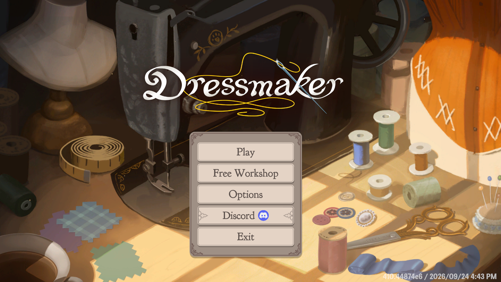

# Free Workshop · Taller libre

A **free design mode** for **Dressmaker** (Cozy Lives / Free Lives, Steam 4019220): just you,
every fabric and all the gold you need. No customers, no story, no deadlines.
*Versión en español más abajo.*

A new **Free Workshop** button appears on the title screen, under *Play*. It opens a separate save with:

- Every pattern, fabric and accessory the game ships as finished.
- 999 999 gold, topped up every time you come in.
- No commissions, story, gossip reports, letters, pigeon quests or tutorials.
- No Steam achievements while you are in it (earn them in your real game).

It saves to its own slot (`player9.json`), hidden from the save menu: **your normal saves are never
touched**. To make a dress: sketchbook → *Create new dress*.

The button follows the game's language: Free Workshop · Taller libre · 自由工坊 · フリー工房.

## Download

**[Latest release](../../releases/latest)** · also on [Nexus Mods](https://www.nexusmods.com/dressmaker).

## Install

1. Install [BepInEx 5 x64](https://github.com/BepInEx/BepInEx/releases) in the folder that holds
   `Dressmaker.exe` (not one level above) and start the game once.
2. Unzip the release into that same folder (it creates `BepInEx\plugins\TallerLibre`).

Works with any game language and alongside other mods. To uninstall, delete the `TallerLibre`
folder; your free-mode save stays in `player9.json` in case you come back.

Tested on build **410.44874e6** (24/09/2026) with BepInEx 5.4.23.5 x64. Found a bug? Open an
[issue](../../issues) with a screenshot.

## Credits

Made by **Masterwin** for his daughters, who haven't left the workshop since.
[MIT](LICENSE). Dressmaker belongs to Cozy Lives; this mod is not official.

---

### Español

Un **modo libre** para diseñar en Dressmaker. En la pantalla de título aparece **«Taller libre»**,
debajo de «Jugar»: una partida aparte con todos los patrones, telas y accesorios, 999 999 monedas
que se rellenan al entrar, y nada de encargos, historia, gacetas, tutoriales ni logros de Steam.
Se guarda en su propia ranura (`player9.json`): **tus partidas normales no se tocan**.

**Instalar**: [BepInEx 5 x64](https://github.com/BepInEx/BepInEx/releases) en la carpeta de
`Dressmaker.exe`, abrir el juego una vez y descomprimir la [última versión](../../releases/latest)
en esa misma carpeta.
